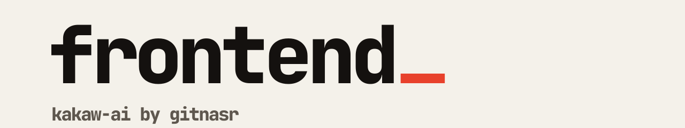

<picture>
  <source media="(prefers-color-scheme: dark)" srcset=".github/banner-dark.svg">
  
</picture>

The web app for [Kakaw AI](https://kakaw.gitnasr.com): ask your database questions in plain English and get tables and charts back. No SQL needed.

[Backend](https://github.com/Kakaw-AI/backend) · [Agent](https://github.com/Kakaw-AI/agent) · [Monitoring](https://github.com/Kakaw-AI/monitoring) · [Site](https://kakaw.gitnasr.com) · [Docs](https://kakaw.gitnasr.com/docs)

## What is in here

Next.js 16 (App Router), React 19, Tailwind CSS 4, better-auth, TanStack Query and d3 for charts. The routes in `src/app/`:

| Route | |
| --- | --- |
| `/` | Landing page |
| `/login` | Sign in with Google or GitHub |
| `/onboarding` | Connect a database and an LLM provider |
| `/chat` | Ask questions, refine queries |
| `/dashboard` | Renders the chat page (not indexed by search engines) |
| `/docs` | Guides (MDX) |
| `/privacy`, `/terms` | Legal pages |

It also serves `llms.txt`, a sitemap and Open Graph images. The site origin is set in `src/lib/site.ts` (override with `NEXT_PUBLIC_SITE_URL`).

## Run it

```bash
npm install
npm run dev     # http://localhost:3000
```

| Script | |
| --- | --- |
| `npm run build` / `start` | Production build and server |
| `npm run lint` | ESLint |

This project uses a Next.js version with breaking changes. Read the guides in `node_modules/next/dist/docs/` before changing framework-level code (see `AGENTS.md`).

## Configuration

The app talks to the [backend](https://github.com/Kakaw-AI/backend). Never commit a `.env` file.
